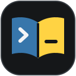
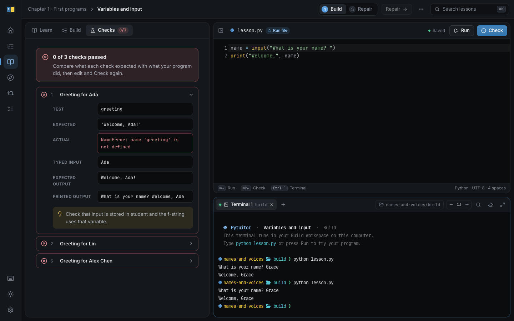

<p align="center">
  
</p>
<h1 align="center">Pytuitor Web</h1>
<p align="center"><strong>Learn Python by building it and fixing it, with a real terminal beside every lesson.</strong></p>
<p align="center">A local browser workbench for macOS and Linux: read a short lesson, write the program, run it in your own shell, and check it against automated tests.<br>
Offline, with no account.</p>
<p align="center">
  <a href="#start-learning">Start learning</a> ·
  <a href="#preview">Preview</a> ·
  <a href="docs/curriculum.md">Curriculum</a> ·
  <a href="docs/architecture.md">Architecture</a> ·
  <a href="https://github.com/dboyza/pytuitor-web/issues">Report an issue</a>
</p>
<p align="center"><strong>84 lessons</strong> &nbsp;/&nbsp; <strong>22 game milestones</strong> &nbsp;/&nbsp; <strong>22 chapters</strong></p>

## Start learning

You need [uv](https://docs.astral.sh/uv/getting-started/installation/) and, to build the browser assets once, Node.js 20.19 or 22.12 or newer.
The first commands download the JavaScript and Python dependencies; uv also downloads Python 3.11+ if needed.
Learning works offline afterward.

```sh
git clone https://github.com/dboyza/pytuitor-web.git
cd pytuitor-web
npm --prefix frontend ci
npm --prefix frontend run build
uv run pytuitor-web
```

Your browser opens the workbench through a one-time sign-in link, which is also printed in the terminal.
Choose **Start learning** for the first lesson or **Browse syllabus** to pick a chapter.
Stop the server with Ctrl+C; your progress is saved as you work.
Use `--data-dir <folder>` for a separate profile and `--no-browser` to print the link only.

## Preview

<a href="docs/assets/workbench.png"></a>

*Check explains each failing case while the program runs for real in the terminal below the editor.*

## How it works

- **Build, then repair.**
  Write each lesson's program from a blank editor, then debug a separate broken program; both stages complete the lesson.
- **A real terminal.**
  Every stage has its own folder and shell on your computer, using JetBrains Mono Nerd Font.
  Run types `python lesson.py` for you, and edits you make from the shell appear in the editor.
- **Clear feedback.**
  Check tests a clean copy of your files and opens the first failure with its input, expected result, actual result, and a hint.
  Hints and a reference solution, with a diff against your draft, are there when you ask for them.
- **Grow your own game.**
  Each chapter extends [Lantern Reach](docs/lantern-reach.md), a text adventure whose working versions you can replay, restore, and download.
- **Your pace.**
  Mark topics you already know, follow optional depth chapters, and use short mixed reviews that never block your progress.

Your programs and shell run with your own user's permissions; process limits are not a security sandbox.
Windows support through PowerShell and ConPTY is implemented but not yet verified.

<details>
<summary>Keyboard shortcuts</summary>

| Action | macOS | Windows and Linux |
| --- | --- | --- |
| Search lessons and pages | ⌘K | Ctrl+K |
| Run in the terminal | ⌘Enter | Ctrl+Enter |
| Check your work | ⌘⇧Enter | Ctrl+Shift+Enter |
| Focus the terminal | Ctrl+\` | Ctrl+\` |
| Show all shortcuts | ? | ? |

</details>

## Development

```text
pytuitor-web/
├── frontend/                React workbench, xterm.js terminal, CodeMirror editor
├── src/pytuitor_web/
│   ├── content/, lessons/   Curriculum forked from Pytuitor
│   ├── service.py           Lessons, disk workspaces, checks, game, and reviews
│   ├── web.py               Authenticated loopback API and WebSockets
│   ├── consoles.py          Pseudo-terminal shells
│   └── runner.py            Isolated check execution
├── tests/                   Curriculum, runner, and API journeys
├── scripts/check.sh         Every local check
└── docs/                    Curriculum, authoring, and architecture guides
```

Run `scripts/check.sh` for ruff, pytest, eslint, prettier, TypeScript, vitest, and the production build.
`npm --prefix frontend run dev` rebuilds the browser assets as you edit; reload the page to see changes.
Read [the architecture guide](docs/architecture.md) before changing sign-in, workspaces, or execution, and [the authoring guide](docs/authoring.md) before changing lessons.

## Next steps

- **Learn:** follow the [curriculum map](docs/curriculum.md) or the [Lantern Reach guide](docs/lantern-reach.md).
- **Contribute content:** use the [authoring guide](docs/authoring.md) and [challenge criteria](docs/teaching-criteria.md), then run `scripts/check.sh`.
- **Report a problem:** [open an issue](https://github.com/dboyza/pytuitor-web/issues) with your operating system, browser, the lesson and stage, what you ran or checked, and the terminal output from `pytuitor-web`.

## License

Pytuitor Web is available under the [MIT License](LICENSE).
The bundled JetBrains Mono Nerd Font is distributed under the [SIL Open Font License](frontend/src/fonts/OFL.txt).
The Inter interface font comes from its npm package under its own SIL Open Font License.
